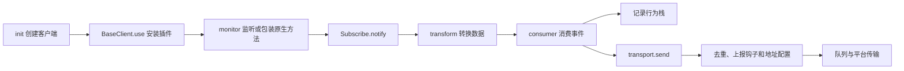

# SDK 代码结构与使用 FAQ

本文说明当前仓库的结构、采集流程和开发方式。本仓库提供 SDK 与示例服务，不包含完整监控平台的存储、查询界面或告警系统。

## 模块结构

| 模块 | 职责 |
| --- | --- |
| `packages/shared` | 事件、错误类型等常量，以及 SDK 名称和版本 |
| `packages/types` | 插件、配置、请求、行为栈和上报数据的公共类型 |
| `packages/utils` | 环境判断、函数包装、错误解析、序列化、队列及错误去重工具 |
| `packages/core` | 客户端基类、配置绑定、发布订阅、行为栈和上报流程 |
| `packages/browser` | 浏览器请求、点击、路由、控制台、资源与代码错误采集；XHR 或图片上报 |
| `packages/wx-mini` | 小程序请求、手势、路由及生命周期采集；通过 `wx.request` 上报 |
| `packages/vue` / `packages/react` | Vue 2/3 错误处理器集成；React ErrorBoundary 和 Context 集成 |
| `packages/web` | 聚合导出 browser、Vue 和 React 功能 |
| `packages/wx-mini-performance` | 独立的小程序性能、网络、内存和电池信息采集入口 |
| `script` / `test` / `examples` | 构建发布脚本、浏览器 E2E 和配置、示例页面及本地服务 |

这是 pnpm workspace 多包仓库，使用 Nx 编排、TypeScript 7 检查、Vite/Rolldown 打包，API Extractor 汇总声明。旧 ES5 产物通过兼容降级阶段保留，详见[工具链迁移与验收](./toolchain-migration.md)。

## 采集与上报流程



- 客户端构造时创建配置、行为栈和平台传输对象。`monitor` 获得 `notify`；`transform` 转换事件；`consumer` 记录行为或提交报告。
- 普通请求、点击等主要提供上下文；异常事件附带行为栈上报。手动 `log` 直接组织日志并进入上报流程。
- `BaseTransport.send` 先执行错误去重并组织 `authInfo`、`data`、`breadcrumb`，再执行 `beforeDataReport`，最后通过 `configReportUrl` 和平台传输方法发送。小程序报告还可以包含设备信息。
- 错误去重工具目前使用模块级计数。多个实例使用相同 apikey 时，不应假设去重额度也彼此隔离。

扩展插件时沿用 `monitor`、`transform`、`consumer` 接口，避免重复实现上报格式。多个实例会增加包装层，应尽量复用同一个业务实例。

## 源码阅读顺序

1. [浏览器入口](../packages/browser/src/index.ts)：默认安装哪些插件。
2. [客户端基类](../packages/core/src/baseClient.ts)与[订阅器](../packages/core/src/subscribe.ts)：插件如何串联。
3. [XHR 插件](../packages/browser/src/plugins/xhr.ts)与[fetch 插件](../packages/browser/src/plugins/fetch.ts)：采集、转换和异常上报。
4. [上报基类](../packages/core/src/baseTransport.ts)与[浏览器传输](../packages/browser/src/browserTransport.ts)：钩子、地址与发送方式。
5. 按需阅读 Vue、React 或小程序适配。小程序性能包有独立入口。

原作者的[架构篇](https://juejin.cn/post/7016897995031445511)和[实现篇](https://juejin.cn/post/7018757658665156639)可作为背景资料，具体文件和行为以当前源码为准。

## 开发与验证

按[贡献指南](../.github/CONTRIBUTING.md)使用 Node 14 和 Yarn 1，在仓库根目录执行：

```sh
pnpm install --frozen-lockfile
pnpm unit
pnpm build browser web
pnpm watch
```

构建默认生成 ESM、CJS、IIFE 和类型声明，产物位于各包 `dist`。建议逐包构建，根脚本的全量构建会同时启动多个任务。

浏览器 E2E 前先构建 browser/web，再在保持运行的终端启动服务：

```sh
node scripts/serve-tests.mjs
```

另一个终端检查 `curl -fsS http://localhost:2021/normal` 返回预期响应，再运行：

```sh
pnpm test:e2e
```

Puppeteer 需要可用浏览器。使用系统 Chromium 时，可设置 `PUPPETEER_SKIP_DOWNLOAD=true` 后安装依赖，并通过 `PUPPETEER_EXECUTABLE_PATH` 指定浏览器。完整测试还包含依赖外部 CDN 的 Vue 2/React 示例。微信 E2E 需要真实微信开发工具并打开服务端口，普通单测不能代替这部分验证。

## FAQ：只记录登录后的操作

登录成功后初始化一次 SDK，可以使登录前不安装采集插件：

```ts
import { init } from '@mitojs/browser'

let monitoring: ReturnType<typeof init> | undefined

export function startMonitoringAfterLogin() {
  if (!monitoring) {
    monitoring = init({ dsn: 'https://monitor.example.com/errors/upload' })
  }
  return monitoring
}
```

由业务登录成功回调调用此函数，不要在每次渲染或路由变化时重新初始化。这里使用本地变量保证初始化一次，不依赖 SDK 自动合并实例。

如果还需登出后停止记录，应分别设计采集、行为栈清理和上报过滤。`beforeDataReport` 返回 `false` 只取消本次上传，不会停止监听或清除行为栈；`beforePushBreadcrumb` 可取消本次入栈。`disabled` 是初始化配置，不是动态暂停、恢复 API。

## FAQ：配置 CORS 后仍无法上报

XHR 上报默认设置 `withCredentials = true`。服务端需为实际页面 Origin 正确处理 OPTIONS 预检和 POST 响应，例如：

```http
Access-Control-Allow-Origin: https://app.example.com
Access-Control-Allow-Credentials: true
Access-Control-Allow-Methods: POST, OPTIONS
Access-Control-Allow-Headers: Content-Type
Vary: Origin
```

Origin 必须与页面匹配，不能使用 `*`。启用 trace 或其他自定义请求头时，允许头列表也应包含实际请求头。预检可以返回 204，实际响应同样需要所需的 CORS 头。

接收服务不需要 cookie 等凭据时，可通过已有钩子关闭：

```ts
init({
  dsn: 'https://monitor.example.com/errors/upload',
  configReportXhr(xhr) {
    xhr.withCredentials = false
  }
})
```

这不替代服务端 CORS 配置。排查时提供 SDK 版本、页面与 dsn 的 Origin、OPTIONS 和实际请求的状态及响应头，并去除 cookie、token 等敏感内容。仅凭“已配置 CORS”不能确定根因。

## FAQ：小程序已有微信日志，还需要 SDK 吗？

按业务需求选择。SDK 将页面、手势、请求和错误关联到行为栈，支持手动日志、业务钩子和指定接收地址，方便 Web 与小程序使用相近的上报流程。它与微信后台日志用途存在差别，并不要求项目同时使用两者。

`examples/server` 只演示静态资源和数据接收接口，没有持久化、错误查询或告警能力。本仓库未包含完整监控平台，本文不承诺平台开源时间。
